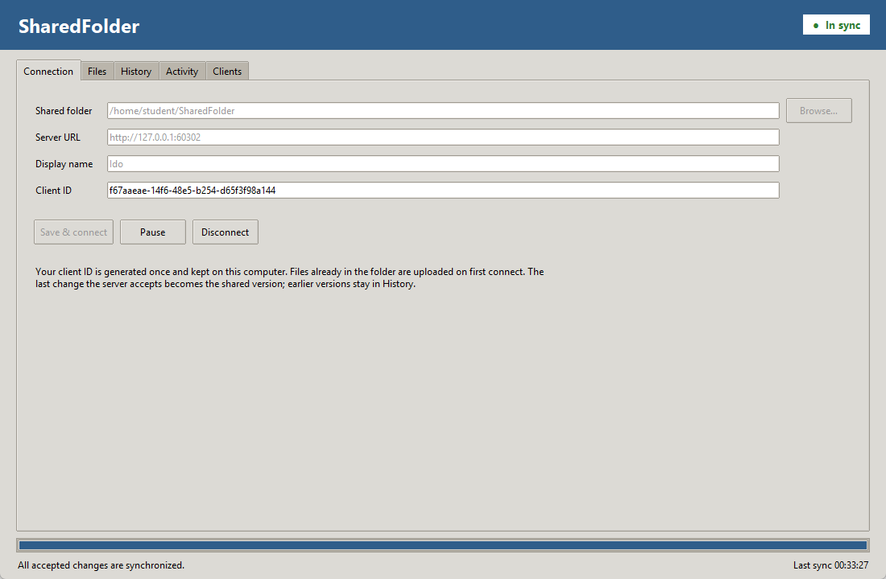
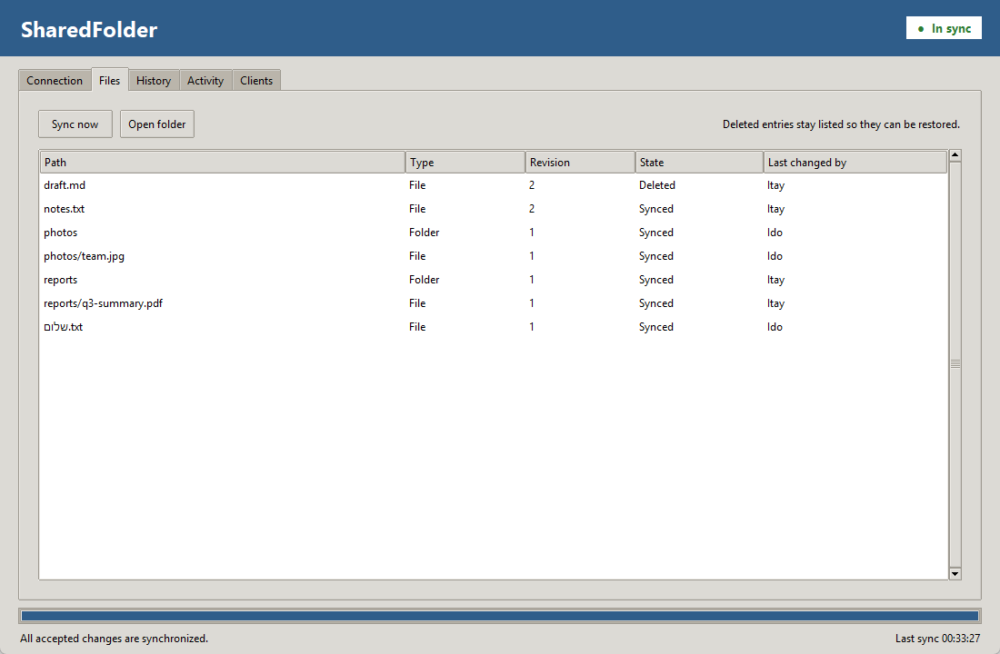
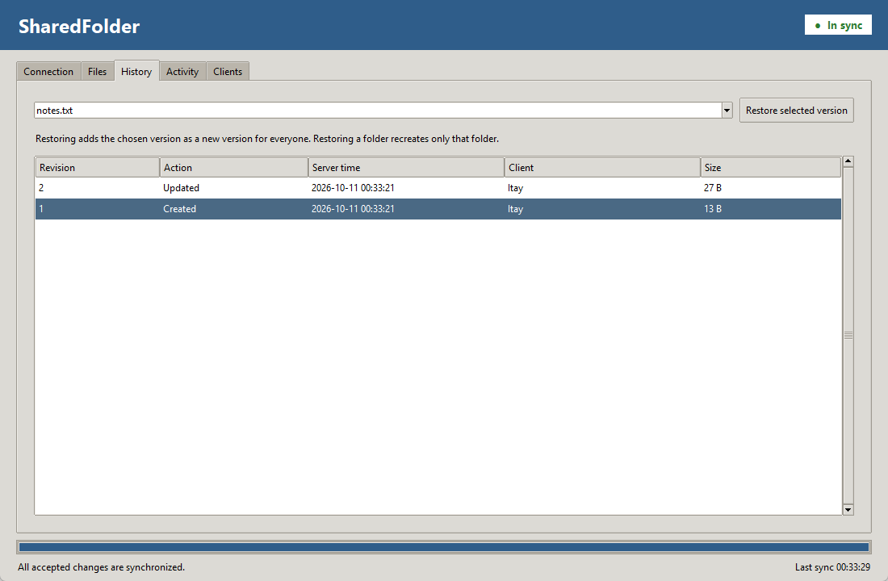
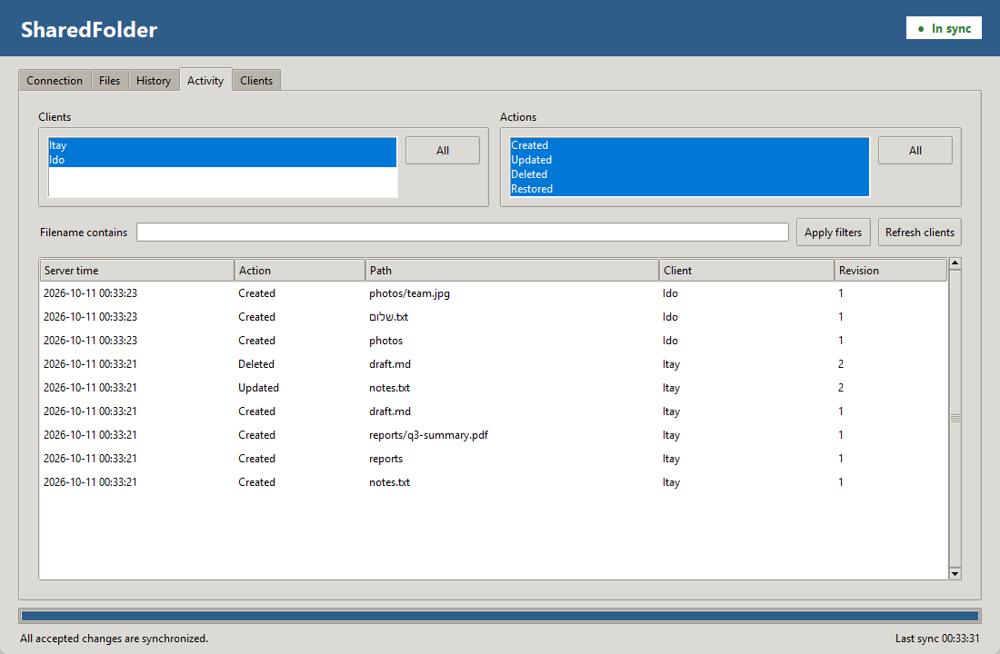
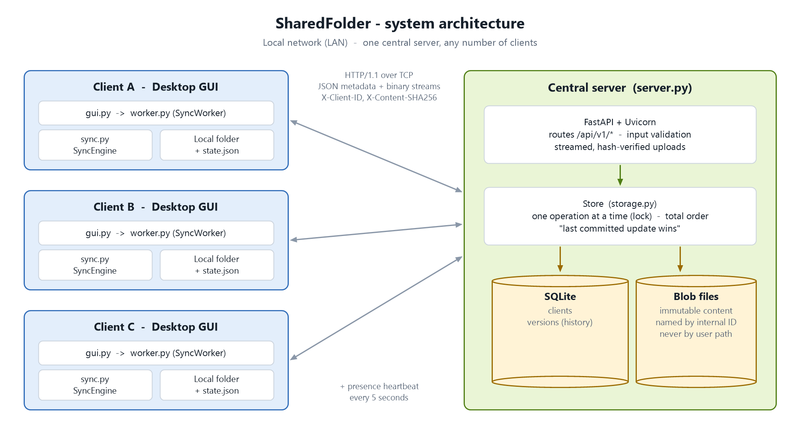
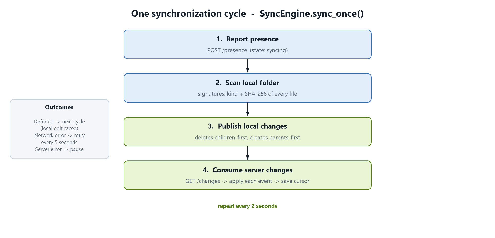

# SharedFolder

A Python 3 application for synchronizing a local folder between Ubuntu computers through one central HTTP server.

It includes a Tkinter desktop client, file and empty-folder synchronization, immutable version history, restoration, an activity log with multi-select filters, and a connected-client list.

**Update rule:** the last complete operation committed by the server wins. Each client generates a persistent UUID and reports a display name. There is no login, token setup, or certificate setup.

Built by **Ido Avraham** and **Itay Akram** as the final project of the Computer Networks Workshop course (20588).

**Tech:** Python · FastAPI + Uvicorn · SQLite · HTTPX (streaming) · Tkinter · pytest



## Install on Ubuntu

Use Python **3.10 or newer**. From the project directory:

```bash
sudo apt-get update
sudo apt-get install -y python3 python3-venv python3-tk
python3 -m venv .venv
source .venv/bin/activate
python -m pip install -r requirements.txt
```

The server needs no desktop. The GUI needs an Ubuntu desktop session. The same project folder runs both roles. `requirements.txt` lists the libraries at the versions used in the local test run.

## Start the server

On the computer that will hold the shared history:

```bash
source .venv/bin/activate
python -m sharedfolder.server
```

Without options, the server listens on port 8000 on every network interface, and keeps its data in `server-data` inside the current directory (created if missing). Both can be changed:

```bash
python -m sharedfolder.server --storage "$HOME/sharedfolder-server" --port 8000
```

Keep that terminal running. Obtain this computer's LAN address, for example using `hostname -I`. Clients use an address such as `http://192.168.1.10:8000`; do not enter `0.0.0.0` in a client. Run one server process per storage directory. A second server on the same port stops at startup with an "address already in use" error.

## Start a desktop client

On each client computer:

```bash
source .venv/bin/activate
python -m sharedfolder.gui
```

In the **Connection** tab:

1. Choose a local folder using **Browse**.
2. Enter the server's HTTP URL.
3. Enter a display name, such as `Ido`.
4. Click **Save & connect**.

The generated ID is saved automatically. Use a different local directory on each computer. All clients connect to the same shared server namespace.

**First connection submits existing local content.** Files identical to the server's current version are kept as they are; files that differ become a new version. An empty local folder downloads the server's current contents.

The default profile folder is `~/.local/share/sharedfolder`. It holds the configuration and the synchronized state. It must be outside the shared folder. Open one window per profile.

To run a separate profile, for example for a second server or shared folder:

```bash
python -m sharedfolder.gui --profile "$HOME/.local/share/sharedfolder-lab-b"
```

Do not copy a profile to a second computer: a new profile generates a new identity.

## Desktop screens

The window uses the standard ttk look with one blue accent colour for the title bar and the progress bar. A badge in the header shows the connection state (grey offline, blue connecting, green in sync, yellow paused, red error). The status bar at the bottom shows a progress bar, the current operation, and the last sync time.

| Tab | Controls |
|---|---|
| Connection | Folder browser, server URL, name, generated ID, connect, pause/resume, disconnect |
| Files | Path, type, revision, state, last source; sync now, open folder |
| History | Path selection, version list, restore selected version |
| Activity | Client and action lists (click a line to select or unselect it) with an All button, filename filter, refresh |
| Clients | Other clients' names, reported states, IPs, last seen, IDs, refresh |

Deleted rows stay listed with the state Deleted, so earlier content can be restored from the History tab. Choosing a path in the History tab shows its versions right away. Restoring asks for confirmation because it creates a new shared revision.

| Files | History | Activity |
|---|---|---|
|  |  |  |

Log selections use OR within a group and AND between groups. Selecting no clients or no actions displays no events.

Pause stops new synchronization work after the active operation finishes. Presence continues. Disconnect and closing the window allow an active operation to finish or time out while retaining queued work. A network failure (no connection, timeout) is retried every 5 seconds. Any other error pauses synchronization; fix the cause and select Resume.

## Behavior to demonstrate

- **Create/update/delete:** changes reach the server and other clients.
- **Empty folders:** folder creation/deletion is represented by metadata events.
- **Last accepted update:** if A commits first and B commits second, B is current. Both accepted file versions remain in history.
- **Offline editing:** saved changes are submitted on reconnection and can replace previously accepted online edits.
- **History:** restore an old file as a new current revision. Restoring a folder recreates only that folder, not an entire historical subtree.
- **Interrupted transfer:** incomplete uploads are not published. Downloads use temporary staging and verified atomic replacement.
- **Network failure:** a change that could not be sent is found again by the next scan and sent when the server is reachable.
- **Live clients:** a separate heartbeat runs every five seconds. A client disappears after fifteen seconds without a heartbeat. Paused clients remain visible.

See [DEMO.md](DEMO.md) for a step-by-step three-client demonstration.

## How synchronization works





1. Scan the local tree, hash every file, and compare it with what was synchronized last time. A file that changes while it is hashed is scanned again in the next cycle.
2. Stream each changed file over HTTP. The server checks its length and hash and commits the change to the database. If the file changed since the scan or during the upload, the client or the server stops the upload and the next cycle sends it again.
3. Fetch ordered server events. Download exact immutable revisions, verify them, and apply them locally.
4. Save the applied revision and event cursor so received files are not uploaded again as new edits.

The server stores content under internal IDs, not user paths. SQLite keeps all versions/events and client records; the current version of a path is its newest version. All requests share one database connection, and a lock lets only one operation use it at a time.

Saved local changes are submitted before remote changes are applied. If a local file was edited since the last sync, the client defers the remote change and submits the local edit first. Unsaved editor buffers cannot be observed by the sync engine.

## Limits

- One shared namespace and equal access for all reachable clients. Names/IDs are reported attribution, not verified identity.
- Plain HTTP on the project LAN.
- Whole files are transferred; failed transfers restart.
- Renames are additions plus deletions. Moving/renaming a directory is not an atomic tree operation.
- Directory deletion proceeds from children to parent. If another client added a file to a folder deleted here, the server rejects the deletion and synchronization pauses with an error. Recreate the folder and select Resume.
- Paths are relative, use forward slashes, and may not contain `..` (which could leave the shared folder). Special files are rejected.
- `.sharedfolder-tmp` is reserved for client download staging and is excluded from synchronization. Leave this directory alone.
- There is no cross-computer editing lock. A save during the download of the same file can be overwritten; only accepted server versions are guaranteed in history.
- Every file is hashed again on each scan (every 2 seconds), so a very large folder uses more CPU.
- File permissions and modification timestamps are not synchronized.
- An inaccessible shared root pauses synchronization; it is not interpreted as deletion of all files.
- All versions are retained; no automatic retention cleanup.
- A server outage stops propagation. Local files remain usable.

## Tests

With the virtual environment active:

```bash
python -m pytest -q
```

Tests run real localhost HTTP servers and independent client folders. They cover the API, synchronization, history, ordering, retries, and server restarts. See [TESTING.md](TESTING.md).

## Project files

```text
sharedfolder/
  constants.py    Protocol values, limits, and timing defaults
  utils.py        Problem error type, path validation, JSON files, hashing
  storage.py      Store: all SQL, the database lock, and content files
  server.py       FastAPI app, routes, request parsing, server entry point
  config.py       Persistent client identity and configuration validation
  transport.py    ApiClient: JSON requests and streaming transfers
  sync.py         SyncEngine and LocalScanner: the synchronization cycle
  worker.py       Background sync thread, presence heartbeat, retry rule
  gui.py          The desktop window: styles, tabs, status bar, and controller
tests/            API, synchronization, and recovery tests
docs/images/      Diagrams and screenshots used in this README
DEMO.md
TESTING.md
requirements.txt
```

Run the commands shown above from the project directory.

## Maintaining the code

Start with `SyncEngine.sync_once()` in `sync.py` to follow a synchronization cycle. `SyncEngine` has two directions: local changes to the server (`_publish_local_changes`, `_upload`, `_save_answer`) and server changes to the local folder (`_consume_changes`, `_apply`, `_perform`). `LocalScanner` walks the folder and hashes every file.

On the server, routes in `server.py` validate input and run `Store` methods through `Store.call`, for example `Store.mutate`. `Store.call` runs one operation at a time under a lock and rolls back a failed change. `Store.mutate()` records a change and commits it; `_apply()` records the change without committing.

In the GUI, `gui.App` builds the window, handles user actions, owns the `SyncWorker`, and shows worker events in `_handle_event()`. The worker communicates only through queues and never touches Tk widgets. Protocol values, limits, and timings are defined in `constants.py`.

Preserve these ordering rules when changing the code:

- Record a change as synchronized only after the server confirmed it; an unconfirmed change is found again by the next scan.
- A server confirmation must not advance the global event cursor.
- Record each change, its parent folders, and its event in one database transaction.
- Delete children before parents; create parents before children. Submit saved local edits before applying remote changes.

Run the full test suite after changing synchronization, storage, or transfer behavior.
